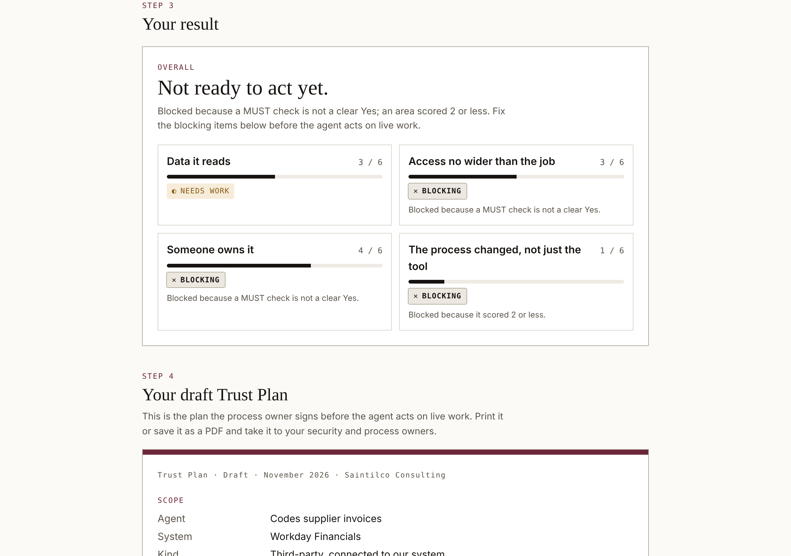
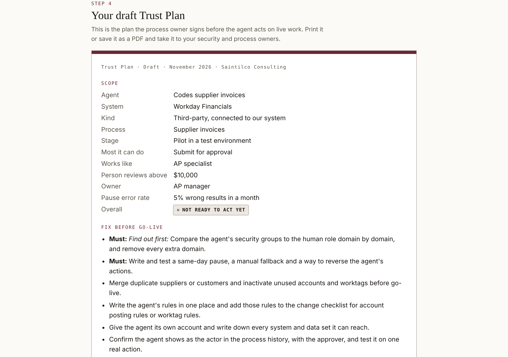

# Agent Readiness Check

**Free. Twelve questions about one AI agent in your finance system. Your answers stay in your browser.**

**Run it:** https://saintilco.com/agent-readiness-check.html

Before an AI agent acts on live finance work, check four things: the data it reads, access no wider than the job, someone who owns it, and a process that changed, not just a tool. Works for Workday Financials, NetSuite, Sage Intacct, QuickBooks Online or another system; the wording follows your system's terms.

You see your result as you answer, then get a draft **Trust Plan**: scope, fixes before go-live, seven acceptance tests, a pause rule, who owns what, and a review cadence. Print it or save it as a PDF.

## How it is scored

Shown on the page: Yes 2, Partly 1, No or Not sure 0. A MUST check that is not a clear Yes, or an area scoring 2 or less, blocks. An agent that can approve, post or pay blocks on its own. A missing owner, review amount, role or pause rate caps the result at "Ready after fixes".

The result is an estimate from your own answers, not a test of your system.

## Sample

`samples/example-trust-plan.pdf` is the printed Trust Plan for the made-up example behind the "See an example" button: an agent that codes supplier invoices, piloted in a test environment.

## How it is tested

Checked in Chrome against the live build on 11 November 2026. All 5 scenarios passed:

| Scenario | Expected and seen |
|---|---|
| All Yes, setup complete, agent can only submit | Ready to act |
| All Yes, but the agent can approve, post or pay | Not ready to act yet, and the reason is named |
| All Yes, no owner or review amount set | Ready after fixes, with the missing items listed |
| All No | Not ready to act yet |
| Example plan | Lists exactly seven acceptance tests |

## What this repository is

A showcase: what the tool does, what it looks like, made-up sample files to try it with, and how it is checked. The tool itself runs on saintilco.com. **No source code, test suites or answer keys are published here.**

Everything in `samples/` is fictional. No client data, real names or real figures appear anywhere in this repository.

## About

Built by [Saintilco Consulting](https://saintilco.com), independent Workday Financials controls reviews. Saintilco Consulting is not affiliated with, sponsored by, or endorsed by Workday, Inc. WORKDAY is a trademark of Workday, Inc. Commercial and systems guidance only, not legal, tax, accounting or audit advice.

Copyright 2026 Saintilco Consulting. All rights reserved. No license is granted to copy, modify or redistribute the tool or this material.
